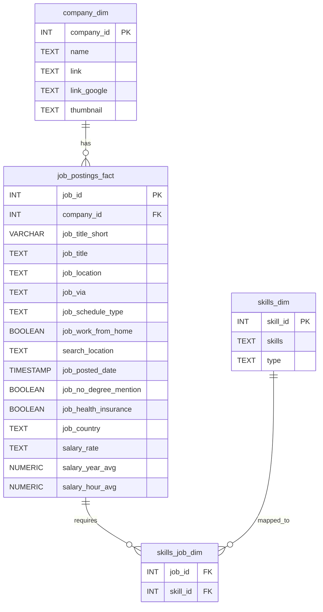

# 📊 SQL Project — Data Analyst Job Market Analysis

An in-depth exploration of the **data analyst job market** using SQL, focused on uncovering the highest-paying roles, the most in-demand skills, and the optimal skills that balance high demand with high salary — empowering data professionals to make strategic career decisions.

---

## 🔍 Project Overview

Navigating the data analyst job market can be overwhelming. This project was built to answer critical questions that every aspiring or current data analyst faces:

- Which roles pay the most?
- What skills do those top-paying roles require?
- Which skills are most sought-after across the industry?
- Which skills command the highest average salaries?
- What are the **optimal skills** — the sweet spot of high demand *and* high pay?

Using real-world job posting data stored in a PostgreSQL database, each question is answered through a dedicated SQL query with clear, reproducible logic.

---

## 🗂️ Repository Structure

```
📦 sql-project-job-market
├── 📂 Project SQL/                  # Core analysis queries
│   ├── top_paying_jobs.sql          # Query 1 — Top paying DA jobs
│   ├── top_paying_job_skills.sql    # Query 2 — Skills for top paying jobs
│   ├── top_demanded_skills.sql      # Query 3 — Most in-demand skills
│   ├── top_paying_skills.sql        # Query 4 — Highest paying skills
│   └── optimal_skills.sql           # Query 5 — Optimal skills (demand + salary)
├── 📂 SQL DATA/
│   ├── 📂 csv_files/                # Raw CSV datasets
│   └── 📂 sql_load/                 # Database setup & data loading scripts
│       ├── 1_create_database.sql
│       ├── 2_create_tables.sql
│       └── 3_modify_tables.sql
├── .gitignore
└── README.md                        # You are here
```

---

## 🛠️ Tools & Technologies

| Tool | Purpose |
|------|---------|
| **PostgreSQL** | Relational database management system used to store and query the data |
| **pgAdmin 4** | GUI client for PostgreSQL, used for database administration and query execution |
| **VS Code** | Code editor used for writing and managing SQL scripts |
| **Git & GitHub** | Version control and project hosting |

---

## 🗃️ Database Schema

The dataset is modeled as a star schema with one central fact table and supporting dimension tables.



### Table Descriptions

| Table | Description |
|-------|-------------|
| `company_dim` | Dimension table containing company details (name, website links, thumbnail) |
| `skills_dim` | Dimension table listing all recognized skills and their category type |
| `job_postings_fact` | Fact table with job posting details — title, location, schedule, salary, and metadata |
| `skills_job_dim` | Bridge/junction table linking jobs to skills (many-to-many relationship) |

---

## 📈 The Analysis

Each query in the `Project SQL/` folder targets a specific business question. Below is a detailed breakdown of each.

---

### 1️⃣ Top Paying Data Analyst Jobs

**File:** [`top_paying_jobs.sql`](Project%20SQL/top_paying_jobs.sql)

**Question:** *What are the top 10 highest-paying Data Analyst roles available remotely?*

```sql
SELECT job_id,
    job_title,
    job_location,
    job_schedule_type,
    salary_year_avg,
    job_posted_date,
    name AS company_name
FROM job_postings_fact
    LEFT JOIN company_dim ON job_postings_fact.company_id = company_dim.company_id
WHERE job_title = 'Data Analyst'
    AND job_location = 'Anywhere'
    AND salary_year_avg IS NOT NULL
ORDER BY salary_year_avg DESC
LIMIT 10;
```

**Key Details:**
- Filters for **exact title** "Data Analyst" with **remote availability** (`job_location = 'Anywhere'`)
- Excludes postings without salary data (`IS NOT NULL`)
- Joins with `company_dim` to retrieve the company name
- Results ordered by average yearly salary in descending order, limited to top 10

**Insight:** This reveals the ceiling of remote Data Analyst compensation and which companies are willing to pay premium rates.

---

### 2️⃣ Skills Required for Top Paying Jobs

**File:** [`top_paying_job_skills.sql`](Project%20SQL/top_paying_job_skills.sql)

**Question:** *What specific skills are required for the top 10 highest-paying Data Analyst jobs?*

```sql
WITH top_paying_jobs AS (
    SELECT job_id,
        job_title,
        salary_year_avg,
        name AS company_name
    FROM job_postings_fact
        LEFT JOIN company_dim ON job_postings_fact.company_id = company_dim.company_id
    WHERE job_title = 'Data Analyst'
        AND job_location = 'Anywhere'
        AND salary_year_avg IS NOT NULL
    ORDER BY salary_year_avg DESC
    LIMIT 10
)
SELECT top_paying_jobs.*,
    skills
FROM top_paying_jobs
    INNER JOIN skills_job_dim ON top_paying_jobs.job_id = skills_job_dim.job_id
    INNER JOIN skills_dim ON skills_job_dim.skill_id = skills_dim.skill_id;
```

**Key Details:**
- Uses a **CTE (Common Table Expression)** to first isolate the top 10 highest-paying remote DA jobs
- Then joins through the bridge table (`skills_job_dim`) to map each job to its required skills
- `INNER JOIN` ensures only jobs with associated skills are returned

**Insight:** Exposes exactly which technical skills the highest-paying employers demand — invaluable for prioritizing your learning path.

---

### 3️⃣ Most In-Demand Skills

**File:** [`top_demanded_skills.sql`](Project%20SQL/top_demanded_skills.sql)

**Question:** *What are the top 5 most frequently requested skills across all Data Analyst job postings?*

```sql
SELECT skills,
    COUNT(skills_job_dim.job_id) AS demand_count
FROM job_postings_fact
    INNER JOIN skills_job_dim ON job_postings_fact.job_id = skills_job_dim.job_id
    INNER JOIN skills_dim ON skills_job_dim.skill_id = skills_dim.skill_id
WHERE job_title_short = 'Data Analyst'
GROUP BY skills
ORDER BY demand_count DESC
LIMIT 5;
```

**Key Details:**
- Counts the number of job postings associated with each skill
- Filters using `job_title_short = 'Data Analyst'` to capture all Data Analyst role variants
- Groups by skill name and ranks by frequency
- No salary or location filters — this is a **market-wide demand snapshot**

**Insight:** Identifies the foundational skills every Data Analyst should have to remain competitive in the job market.

---

### 4️⃣ Top Skills Based on Salary

**File:** [`top_paying_skills.sql`](Project%20SQL/top_paying_skills.sql)

**Question:** *Which skills are associated with the highest average salaries for Data Analysts?*

```sql
SELECT skills,
    ROUND(AVG(salary_year_avg), 0) AS avg_salary
FROM job_postings_fact
    INNER JOIN skills_job_dim ON job_postings_fact.job_id = skills_job_dim.job_id
    INNER JOIN skills_dim ON skills_job_dim.skill_id = skills_dim.skill_id
WHERE job_title_short = 'Data Analyst'
    AND salary_year_avg IS NOT NULL
GROUP BY skills
ORDER BY avg_salary DESC
LIMIT 10;
```

**Key Details:**
- Calculates the **average annual salary** for each skill using `AVG()`, rounded to the nearest dollar
- Only includes postings with non-null salaries
- No location restriction — covers both remote and on-site roles
- Top 10 skills by average salary

**Insight:** Reveals niche or specialized skills that command premium pay. These may differ significantly from the most *in-demand* skills — high pay doesn't always equal high demand.

---

### 5️⃣ Optimal Skills (High Demand + High Salary)

**File:** [`optimal_skills.sql`](Project%20SQL/optimal_skills.sql)

**Question:** *What are the most optimal skills to learn — those that are both in high demand AND offer high salaries?*

```sql
WITH skills_demand AS (
    SELECT skills_dim.skill_id,
        skills_dim.skills,
        COUNT(skills_job_dim.job_id) AS demand_count
    FROM job_postings_fact
        INNER JOIN skills_job_dim ON job_postings_fact.job_id = skills_job_dim.job_id
        INNER JOIN skills_dim ON skills_job_dim.skill_id = skills_dim.skill_id
    WHERE job_title_short = 'Data Analyst'
        AND salary_year_avg IS NOT NULL
    GROUP BY skills_dim.skill_id
),
average_salary AS (
    SELECT skills_dim.skill_id,
        skills_dim.skills,
        ROUND(AVG(salary_year_avg), 0) AS avg_salary
    FROM job_postings_fact
        INNER JOIN skills_job_dim ON job_postings_fact.job_id = skills_job_dim.job_id
        INNER JOIN skills_dim ON skills_job_dim.skill_id = skills_dim.skill_id
    WHERE job_title_short = 'Data Analyst'
        AND salary_year_avg IS NOT NULL
    GROUP BY skills_dim.skill_id
)
SELECT skills_demand.skill_id,
    skills_demand.demand_count,
    average_salary.avg_salary
FROM skills_demand
    INNER JOIN average_salary ON skills_demand.skill_id = average_salary.skill_id
WHERE skills_demand.demand_count > 10
ORDER BY average_salary.avg_salary DESC,
    skills_demand.demand_count DESC
LIMIT 10;
```

**Key Details:**
- Uses **two CTEs**: one for demand counts, one for average salaries
- Joins both on `skill_id` to produce a combined view
- Filters out low-demand skills (`demand_count > 10`) to avoid statistical outliers
- Results sorted by salary first, then demand as a tiebreaker
- This is the **most strategic query** in the project

**Insight:** The "optimal skills" sit at the intersection of marketability and earning potential. These are the skills that provide both **job security** (high demand) and **financial reward** (high salary) — the best investments for career development.

---

## 🚀 Getting Started

### Prerequisites

- [PostgreSQL](https://www.postgresql.org/download/) (v16+ recommended)
- [pgAdmin 4](https://www.pgadmin.org/download/)
- [VS Code](https://code.visualstudio.com/) (optional, for editing SQL files)

### Setup Instructions

1. **Clone the repository**
   ```bash
   git clone https://github.com/M-Awad-27/sql-project-job-market.git
   cd sql-project-job-market
   ```

2. **Create the database**
   - Open pgAdmin and run the script in `SQL DATA/sql_load/1_create_database.sql`

3. **Create the tables**
   - Execute `SQL DATA/sql_load/2_create_tables.sql` to set up the schema

4. **Load the data**
   - Place the CSV files in a directory accessible to PostgreSQL
   - Update the file paths in `SQL DATA/sql_load/3_modify_tables.sql` to match your system
   - Execute the script to load the data

   > **💡 Tip:** If you encounter permission errors, use the `\copy` commands in the PSQL Tool instead of `COPY`. See the comments in `3_modify_tables.sql` for detailed instructions.

5. **Run the analysis queries**
   - Open and execute the SQL files in the `Project SQL/` folder in any order

---

## 📝 Key Takeaways

| # | Insight | Detail |
|---|---------|--------|
| 1 | **Top-paying DA roles are remote** | The highest-paying Data Analyst positions offer remote flexibility, with salaries significantly above market average |
| 2 | **Premium skills for premium pay** | Top-paying roles consistently require advanced tools and technologies beyond basic SQL and Excel |
| 3 | **SQL dominates demand** | SQL remains the single most requested skill across all Data Analyst job postings |
| 4 | **Niche skills pay more** | Specialized tools and technologies command higher average salaries, even if they appear in fewer postings |
| 5 | **Optimal skills balance both** | The best career investment lies in skills that are both frequently requested and well-compensated |

---

## 🤝 Contributing

Contributions are welcome! If you'd like to add new queries, improve existing analysis, or enhance the documentation:

1. Fork the repository
2. Create a feature branch (`git checkout -b feature/new-analysis`)
3. Commit your changes (`git commit -m 'Add new analysis query'`)
4. Push to the branch (`git push origin feature/new-analysis`)
5. Open a Pull Request

---

## 📄 License

This project is open source and available for educational and portfolio purposes.

---

## 🙏 Acknowledgments

- Job posting data sourced for educational data analysis purposes
- Inspired by real-world data analyst career exploration

---

<p align="center">
  <i>Built with ❤️ and SQL</i>
</p>
